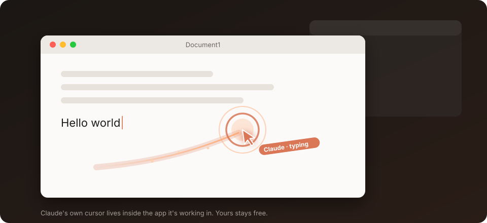

<div align="center">



# Claude Cursor

**See exactly where your AI agent is clicking without giving up your own mouse.**

An opt-in, click-through, orange **"Claude"** cursor that lives *inside the one app window* Claude is working in. It glides, tilts, sparkles and ripples on every click. Your real pointer and keyboard stay yours the whole time.

[](mac/)
[](windows/)
[](https://github.com/KanishkThakar/claude-cursor/actions/workflows/windows.yml)
[](mac/ghost.swift)
[](LICENSE)
[](skills/claude-cursor/SKILL.md)

</div>

---

## Why

AI agents that drive desktop apps are great until you can't tell what they're doing. Most of them either:

- **steal your mouse and keyboard** (you have to sit on your hands), or
- **act invisibly in the background** (you have no idea where they clicked).

Claude Cursor fixes the second problem without causing the first. Claude acts through background, app-bound controls (Accessibility actions on macOS, UI Automation on Windows), and this cursor shows *where* those actions land, right inside the target window.

## Features

| | |
|---|---|
| 🪟 **Window-bound** | Drawn only inside the target window and clipped to its edges. It sits directly above that window, so any other window in front covers it. |
| 🧲 **Follows the window** | Move or resize the window and the cursor stays with it. It hides when the window is minimised, closed or on another Space. |
| 🖱️ **Never takes over** | Click-through, non-activating, no Dock icon. It never moves your pointer or takes keyboard focus. |
| 🔒 **No scary permissions** | The overlay needs no Accessibility or Screen Recording permission. |
| ✨ **Feels alive** | Spring glide with a little overshoot, tilts as it moves, a comet trail, sparks, a breathing glow, and a double ripple with a press squish on clicks. |
| 🏷️ **Narrates** | The label shows what Claude is doing: `Claude · typing`, `Claude · reading`… It flips to stay inside the window at the edges. |
| ✅ **Opt-in** | Nothing appears unless you ask for it. Every command except `start` is a no-op when it's off. |
| 🪶 **Light** | Core Animation on the GPU: about 0.6% CPU and 38 MB at idle on Apple silicon. It quits by itself after 20 minutes without updates. |
| 🤖 **Claude Code skill** | Drop-in skill: `/claude-cursor open TextEdit and type hello`. |

## Quick start (Windows) — one click

No admin, nothing to install first. Paste into PowerShell:

```powershell
irm https://raw.githubusercontent.com/KanishkThakar/claude-cursor/main/windows/install.ps1 | iex
```

…or download **[ClaudeCursor-windows.zip](https://github.com/KanishkThakar/claude-cursor/releases/latest/download/ClaudeCursor-windows.zip)**, unzip it and double-click **`install.cmd`**. It builds the cursor, adds `claude-cursor` to your PATH, installs the Claude Code skill and runs a live demo in Notepad. Details in [`windows/`](windows/).

```powershell
claude-cursor start --app notepad
claude-cursor demo
claude-cursor stop
```

## Quick start (macOS)

Requires the Xcode Command Line Tools (`xcode-select --install`).

```bash
git clone https://github.com/KanishkThakar/claude-cursor.git
cd claude-cursor/mac
./install.sh            # builds the cursor
./install.sh --skill    # optional: also installs the Claude Code skill
```

Try it on any window:

```bash
./claude-cursor.sh start --app Finder      # appears inside Finder's front window
./claude-cursor.sh say "Claude · reading"  # change the label
./claude-cursor.sh click 400 300           # glide + ripple (global top-left points)
./claude-cursor.sh demo                    # show-off tour inside the window
./claude-cursor.sh stop                    # fade out
```

## Commands

| Command | What it does |
|---|---|
| `start --app "App" [--title T] [X Y]` | Show the cursor inside that app's window. It finds windows on other Spaces too. |
| `start --window WID [X Y]` | Bind to an exact `CGWindowID` |
| `attach --app "App" [--title T]` | Jump into another window while running |
| `move X Y [1]` | Glide to a point; `1` adds the click effect |
| `click X Y` | Glide and ripple |
| `say TEXT` | Set the label |
| `find "App" [TITLE]` | Print `wid x y w h title` for that app's window |
| `demo` | Short tour inside the bound window |
| `status` / `stop` | Report status / fade out and quit |
| `start --screen` | Old whole-screen overlay. Only use it if you really want it. |

Coordinates are **global top-left points**: the same space as Accessibility `AXPosition` and `CGWindowList` bounds. To point at a UI element, use the centre of its AX frame: `AXPosition + AXSize / 2`.

## Use it with Claude Code

`./install.sh --skill` installs [`skill/SKILL.md`](skills/claude-cursor/SKILL.md) to `~/.claude/skills/claude-cursor/`. Then:

```text
/claude-cursor open TextEdit and type hello
/claude-cursor off
```

The skill tells Claude to:
1. open the app;
2. bind the cursor to its window;
3. point at each element right before acting on it (the label says what it's doing);
4. stop the cursor at the end.

The real clicks and typing still go through your background computer-use controller. The cursor is only ever an indicator; it never fakes an action.

## How it works

```
 Claude Code ──► claude-cursor.sh ──writes──► ~/Library/Caches/claude-ghost/state.txt
                                                        │  "x|y|label|click|stamp|wid"
                                                        ▼
                         claude-ghost (Swift, AppKit + Core Animation, 60 fps)
                           • reads the state file when it changes
                           • asks the window server for the target window's frame (~10×/s)
                           • keeps a borderless, click-through NSPanel exactly on that frame,
                             ordered directly above the target window, hidden when it's off screen
                           • animates the arrow with spring physics on GPU layers
```

- **Overlay:** an `NSPanel` with `.nonactivatingPanel` and `ignoresMouseEvents = true`. The app runs with the `.accessory` activation policy, so it has no Dock icon and never becomes the active app.
- **Window binding:** `CGWindowListCopyWindowInfo` gives the target's frame and on-screen state. `order(.above, relativeTo:)` keeps the panel right on top of it and nowhere else.
- **Rendering:** `CAShapeLayer` for the arrow, glow and trail, `CAEmitterLayer` for sparks, and `CAAnimationGroup` for the ripples.

## Platform status

| Platform | Status | Tested on |
|---|---|---|
| **macOS** | ✅ Working | macOS 26.6, Apple silicon (M5 Max), Swift 6.4. Built, positioned to within 1 px, bound to Microsoft Word and test windows, and confirmed click-through. |
| **Windows** | ✅ Working | Windows 10/11. Built by the `csc.exe` that ships with Windows; Built with the `csc.exe` that ships with Windows; every push is compiled and smoke-tested in Notepad by [CI](.github/workflows/windows.yml), including the one-line installer. |
| Multiple monitors (macOS) | ⚠️ Untested | Should work (one panel, global coordinates). Reports welcome. |

## FAQ

**Does it move my mouse?** No. It's a picture drawn in a transparent window. Your pointer is never touched.

**Can it click things?** No, by design. Clicking is done by your agent's background controller; the cursor only shows where.

**Why does it disappear when I switch apps?** Because it belongs to the target window. If another window covers the target, it covers the cursor too.

**Does it need Accessibility permission?** The cursor doesn't. Your agent's controller probably does, for the real actions.

## Roadmap

- [x] Windows source in `windows/` with a one-click installer
- [ ] Homebrew tap (`brew install claude-cursor`)
- [ ] Multi-monitor testing
- [ ] Typing indicator (caret sparkle while text is being entered)
- [ ] Themes (colours and label styles)

## Contributing

Issues and pull requests are welcome. See [CONTRIBUTING.md](CONTRIBUTING.md).

## Author

Built by **[Kanishk Thakar](https://github.com/KanishkThakar)**. If this saved you from wondering *"wait, what did the AI just click?"*, give it a ⭐.

## License

[MIT](LICENSE) © 2026 Kanishk Thakar
